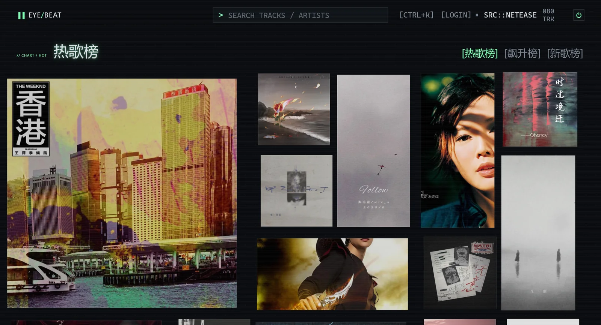
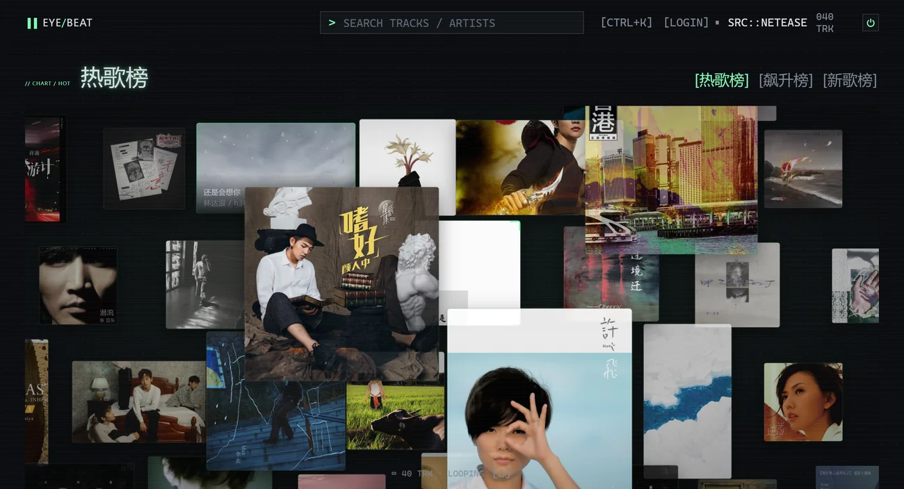
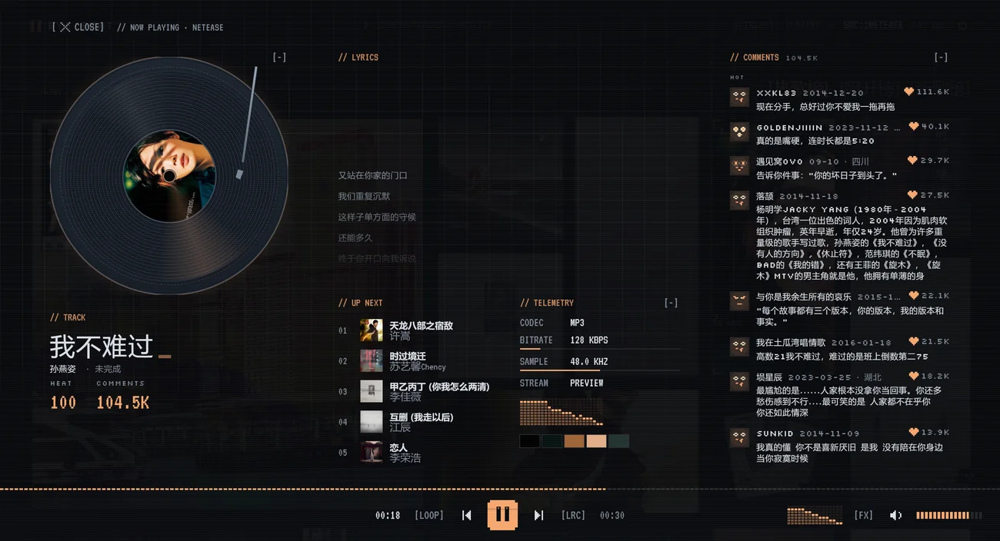
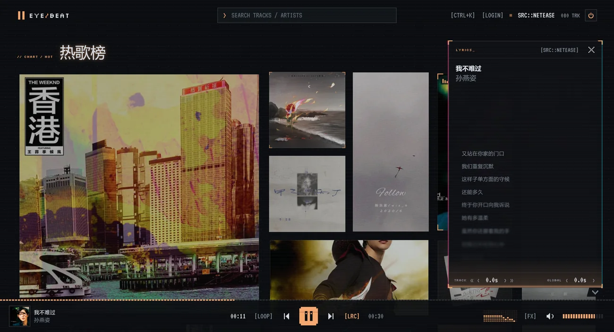
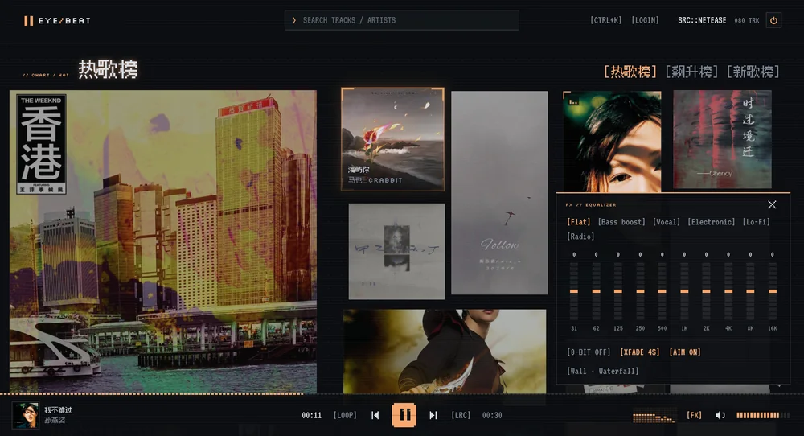
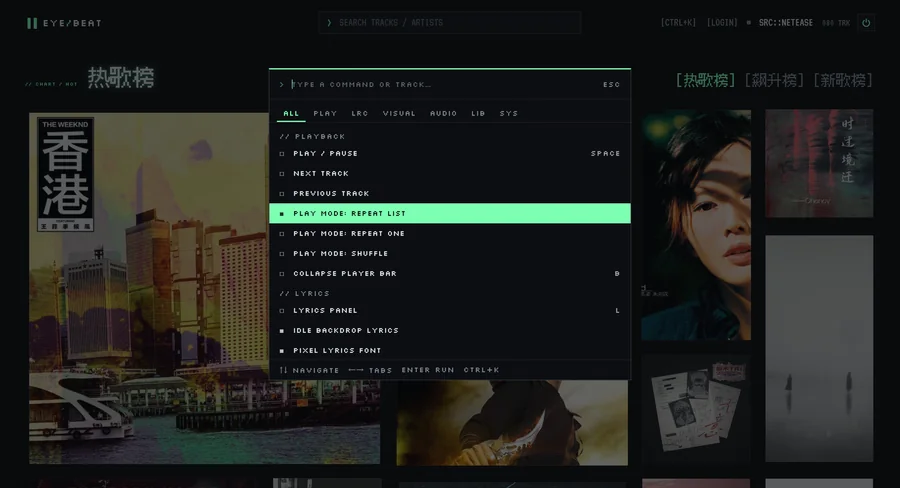
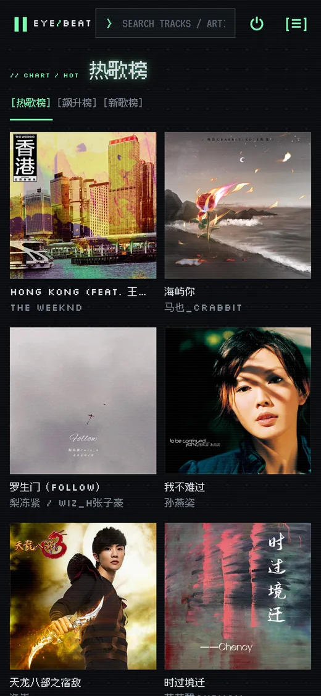

<p align="center">
  
</p>

<div align="center">

# EYE/BEAT

**像素风封面墙音乐播放器**

换一首歌，整面墙就换一种颜色。

[](https://bugdesigner-hy.github.io/eyeBeat/)
[](https://github.com/BugDesigner-Hy/eyeBeat/actions/workflows/deploy.yml)
[](https://github.com/BugDesigner-Hy/eyeBeat/stargazers)
[](https://github.com/BugDesigner-Hy/eyeBeat/commits/main)
[](https://vuejs.org)
[](https://vite.dev)
[](https://web.dev/progressive-web-apps/)
[](https://github.com/BugDesigner-Hy/eyeBeat/releases/latest)
[](LICENSE)

[**▶ 在线体验**](https://bugdesigner-hy.github.io/eyeBeat/) ·
[快速开始](#快速开始) · [界面一览](#界面一览) ·
[特性](#特性) ·
[部署](#部署成自己的站点) ·
[常见问题](#常见问题) ·
[反馈问题](https://github.com/BugDesigner-Hy/eyeBeat/issues)

</div>

## 这是什么

一个跑在浏览器里的音乐播放器。它把歌曲以**封面**为最小单位排成一面墙：点开一张封面进入详情页开始播放，整套界面的强调色由当前封面实时取色，换歌即换色。

视觉是像素 / 霓虹 / 终端：中文用 Ark Pixel 12px，拉丁文用 VT323 与 Silkscreen，动效尽量做成「机器正在工作」的样子。待机时屏幕像 CRT 老电视一样关掉，只留七段数码管时钟和一只跟着光标转动的机器人。

纯前端实现，没有后端；播放进度、设置、评论缓存都存在浏览器本地。已适配桌面与手机，可以安装成 App 离线使用。顶栏右上角的 GitHub 图标直达源码仓库。

**适合**：想要一个好看、打开就能听、还能直接分享链接的网页播放器；喜欢像素 / CRT / 霓虹风格。

**不适合**：要管理本地音乐文件、要桌面客户端、或者必须离线播放自有曲库 —— 那些需求更适合 [Folia](https://github.com/chthollyphile/folia-major)、[Navidrome](https://www.navidrome.org/)、[Feishin](https://github.com/jeffvli/feishin) 这类本地曲库播放器。

## 界面一览

<p align="center">
  
  
</p>

<p align="center"><sub><b>无限画布布局</b>：封面散在纵深里，拖动即可漫游 · <b>详情页</b>：黑胶唱片、逐行歌词、热门评论、队列与遥测</sub></p>

<p align="center">
  
  
</p>

<p align="center"><sub><b>歌词面板</b>：多候选源、单曲与全局偏移 · <b>FX 面板</b>：10 段 EQ、六套预设、8-bit 降位、交叉淡入</sub></p>

<p align="center">
  
  
</p>

<p align="center"><sub><b>命令面板</b>：所有开关都能搜到 · <b>待机屏</b>：CRT 关机、七段时钟、盯着光标的机器人</sub></p>

<p align="center">
  
</p>

<p align="center"><sub>移动端：两列封面墙，上滑歌词、右滑评论</sub></p>

<sub>以上截图由 Chrome DevTools 协议自动抓取（`pnpm screenshot`），不含任何录屏水印，可随时重跑。</sub>

## 快速开始

### 环境要求

| 依赖 | 版本 | 说明 |
| --- | --- | --- |
| Node.js | `>= 20.19` 或 `>= 22.12` | Vite 8 的硬要求，推荐用 22 LTS |
| pnpm | `>= 10` | `npm i -g pnpm`，或 `corepack enable pnpm` |
| 浏览器 | Chrome / Edge / Safari 最新版 | 需要 Web Audio 与 ES2022 |

### 方式一：直接打开网页（零安装）

<https://bugdesigner-hy.github.io/eyeBeat/>

电脑和手机都能用，不需要注册。想长期使用就往下看「方式二」。

### 方式二：安装成 App（PWA）

站点是标准 PWA，装好后有独立图标与独立窗口，断网也能打开应用外壳：

| 平台 | 操作 |
| --- | --- |
| 桌面 Chrome / Edge | 点地址栏右侧的 ⊕ 安装图标 → 安装 |
| Android Chrome | 菜单 → 安装应用 / 添加到主屏幕 |
| iOS Safari | 分享 → 添加到主屏幕 |

### 方式三：本地运行

```bash
git clone https://github.com/BugDesigner-Hy/eyeBeat.git
cd eyeBeat
pnpm install
pnpm dev
```

终端出现 `Local: http://localhost:5173/` 即启动成功，用浏览器打开即可。

开发模式会同时拉起两个本地 API 子进程：网易云（端口 `3000`，日志前缀 `[ncm]`，代理到 `/ncm`）和 QQ 音乐（端口 `3200`，日志前缀 `[qq]`，代理到 `/qq`）。端口被占用时会直接复用已在运行的服务。

> [!TIP]
> 想换默认音源：复制 `.env.example` 为 `.env.local`，改 `VITE_MUSIC_PROVIDER`（`audius` / `netease` / `qq` / `jamendo`），**改完需重启 `pnpm dev`**。

其他常用命令：

```bash
pnpm build      # vue-tsc 类型检查 + 生产构建，产物在 dist/
pnpm preview    # 本地预览构建产物
```

> [!NOTE]
> 没有配置 Jamendo 的 `client_id` 时，Jamendo 不会出现在切换列表里；网易云与 QQ 音乐都需要 API 地址，否则不会出现在列表里。线上演示站没有后端，默认用 Audius。

## 部署成自己的站点

### GitHub Pages（本仓库的做法）

1. 点右上角 **Fork** 复制到你的账号
2. 仓库 **Settings → Pages → Source** 选 **GitHub Actions**
3. 打开 `.github/workflows/deploy.yml`，把 Build 步骤的 `BASE_PATH` 改成 `/<你的仓库名>/`
4. push 到 `main`；Actions 跑完即可访问 `https://<你的用户名>.github.io/<仓库名>/`

### Vercel / Netlify / Cloudflare Pages

| 设置项 | 值 |
| --- | --- |
| Build command | `pnpm build` |
| Output directory | `dist` |
| Node version | `22`（或 ≥ 20.19） |
| 环境变量 | 根路径部署不用设；子路径部署设 `BASE_PATH=/<子路径>/` |

### 自己的服务器（Nginx）

```bash
pnpm install && pnpm build              # 构建
rsync -av dist/ user@host:/var/www/eyeBeat/   # 只上传静态产物，无需 Node 常驻
```

```nginx
server {
    listen 80;
    server_name music.example.com;
    root /var/www/eyeBeat;

    location / {
        try_files $uri $uri/ /index.html;
    }
}
```

### 子路径部署必须设置 BASE_PATH

> [!IMPORTANT]
> 部署到 `https://example.com/music/` 这类子路径却忘了设 `BASE_PATH=/music/`，页面会白屏或资源 404：`index.html` 里的资源地址、PWA 的 `scope` 与 `start_url`、Service Worker 的缓存匹配都依赖它。根路径部署则不用设。

## 特性

| 模块 | 说明 |
| --- | --- |
| 封面墙 | 瀑布流 / Folia 式无限画布两种布局，鼠标拖动或方向键浏览，`Enter` 播放 |
| 主色联动 | 从当前封面取主色驱动整套主题，也可固定为四种预设色之一 |
| 准星定位 | 切歌时准星飞到新歌封面并锁定，墙再大也不会迷路 |
| 播放与音效 | 循环 / 单曲 / 随机、交叉淡入（默认 4s）、10 段 EQ 六套预设、Bitcrush lo-fi、频谱可视化 |
| 歌词 | LRCLIB 多候选匹配，单曲偏移 ±0.1s 与全局偏移（补偿蓝牙延迟），像素字体可切 |
| 详情与评论 | 黑胶封面、歌词、评论、接下来播放、数据面板；宽屏可把三栏分别折叠成细轨 |
| 待机屏 | CRT 关机动画、七段数码管时钟、互动机器人；`P` 键或长按充能开机 |
| 多音源 | Audius / 网易云 / QQ 音乐 / Jamendo，能力差异与配置见下方[音乐源](#音乐源) |
| 命令面板 | `Ctrl/Cmd + K` 搜到所有开关：音源、EQ、配色、布局、语言、歌词偏移 |
| 安装与离线 | PWA 可安装；中文字体按 `unicode-range` 分片按需加载，不进预缓存 |

<details>
<summary>展开看几个实现细节</summary>

- **主色取色**：封面解码到 canvas 后做量化与对比度修正，只取一个强调色，其余颜色由 CSS 变量推导，保证深色底上的可读性
- **空间导航**：封面墙维护屏幕坐标，方向键按真实方位（而不是列表顺序）选邻居，画布布局下同样成立
- **歌词偏移**：单曲偏移写入该曲目的本地记录，全局偏移对所有歌曲生效，用来抵消蓝牙耳机 150~300ms 的延迟
- **待机屏**：关机不是隐藏播放器，而是切到独立的 CRT 屏，音频淡出后暂停，开机时恢复

</details>

## 音乐源

顶栏 `SRC::` 循环切换，或在命令面板（`Ctrl/Cmd + K`）里搜音源名。

| 音源 | 榜单 / 搜索 | 歌词 | 评论 | 播放 | 需要什么 |
| --- | --- | --- | --- | --- | --- |
| [Audius](https://audius.co) | ✅ / ✅ | LRCLIB | ✅ | 开箱即播 | 无需配置 |
| 网易云 | ✅ / ✅ | 自带歌词 | ✅ | 部分需要登录 | 自备 API：`VITE_NETEASE_API_BASE` |
| QQ 音乐 | ✅ / ✅ | 自带歌词 | ✅ | 基本都要登录 | 自备 API：`VITE_QQ_API_BASE` |
| [Jamendo](https://www.jamendo.com) | ✅ / ✅ | LRCLIB | — | 开箱即播 | `client_id` |

几个差别值得知道：

- **登录**：顶栏 `[LOGIN]` 扫码，弹窗会按当前音源自动出码（网易云 / QQ 音乐）。凭证只保存在本机，退出登录即清除。
- **分区**：需要登录的分区（网易云的「每日推荐」「我喜欢的音乐」，QQ 音乐的「我喜欢的音乐」）**登录后才出现**；未登录只有公开榜单。
- **音质**：QQ 音乐按账号权限依次尝试 FLAC → 320K → 128K；网易云固定取 `exhigh`。
- **主色取色依赖封面 CORS**：Audius、网易云、Jamendo 的封面 CDN 放行，能取色；QQ 音乐的 `y.gtimg.cn` 不放行，切过去会退回固定配色。音频 CDN 是放行的，所以频谱与音效不受影响。
- **平台差异**：网易云与 QQ 音乐都由社区维护的非官方接口提供，部署到公网前请自行评估；官方演示站只带 Audius。

## 配置

复制 [`.env.example`](.env.example) 为 `.env.local`（或沿用仓库内的 `.env.development`），改完需重启。

| 变量 | 默认 | 说明 |
| --- | --- | --- |
| `VITE_MUSIC_PROVIDER` | `audius` | 默认音源：`audius` \| `netease` \| `qq` \| `jamendo` |
| `VITE_NETEASE_API_BASE` | 空 | 网易云 API 地址。以 `/` 开头时由 dev server 代理并自动起本地服务（如 `/ncm`）；填完整 URL 则直接请求 |
| `NETEASE_API_PORT` | `3000` | 内置网易云 API 服务端口 |
| `VITE_QQ_API_BASE` | 空 | QQ 音乐 API 地址（[`@yakult-green-tea/qq-music-api`](https://github.com/yakult-green-tea/qq-music-api)）。`/qq` 由 dev server 拉起并代理；也可填自部署服务的地址 |
| `QQ_API_PORT` | `3200` | 内置 QQ 音乐 API 服务端口 |
| `VITE_JAMENDO_CLIENT_ID` | 空 | 在 [Jamendo Dev Portal](https://devportal.jamendo.com/) 申请；未配置则不出现在切换列表 |
| `BASE_PATH` | `/` | 构建时的站点子路径，部署到 `https://<user>.github.io/eyeBeat/` 时为 `/eyeBeat/` |

## 键盘与手势

| 按键 | 作用 |
| --- | --- |
| `Space` | 播放 / 暂停 |
| `Shift` + `←` / `→` | 后退 / 前进 5 秒 |
| `←` `→` `↑` `↓` | 在封面墙中移动选择 |
| `Enter` | 播放选中的封面 |
| `L` | 歌词面板 |
| `B` | 折叠 / 展开播放栏 |
| `P` | 关机 / 开机 |
| `/` | 打开命令面板并进入搜索 |
| `Ctrl` / `Cmd` + `K` | 命令面板 |
| `Esc` | 逐层关闭浮层 |

移动端：上滑进入歌词、右滑进入评论、下滑返回。

## 技术栈与结构

**Vue 3** + **TypeScript** + **Pinia** + **Vite 8** + **vite-plugin-pwa**，音频走 Web Audio（EQ、bitcrusher、频谱），封面取色与六边形布局都在 canvas 与纯函数里完成。

```
src/
  api/            音乐源适配器（audius / netease / qq / jamendo）、歌词源（LRCLIB）
  audio/          Web Audio 引擎、EQ、bitcrusher
  components/     界面组件（封面墙、详情页、待机屏、命令面板…）
  composables/    相机、折叠、响应式等组合式逻辑
  stores/         Pinia：播放器、歌词、评论、设置、UI、账号
  utils/          六边形网格、取色、空间导航、IndexedDB
  i18n/           中英文案
public/           图标、像素字体
scripts/          本地 API 子进程插件（网易云 / QQ 音乐）、图标生成、截图脚本
```

新增音源：在 `src/api/providers/` 实现 `src/api/types.ts` 里的 `MusicProvider`，再到 `src/api/index.ts` 注册即可。

## 常见问题

<details>
<summary><b>点播放没声音？</b></summary>

浏览器的自动播放策略要求先有用户手势。先点一下页面任意位置或播放按钮；仍无声请检查系统音量、输出设备，以及页面是否被静音。

</details>

<details>
<summary><b>本地默认是网易云，线上打开却是 Audius？</b></summary>

本地由 `.env.development` 指定了网易云并自动起了 API；线上构建没有该配置，回落到 Audius。想在线上用网易云，需要自己部署 API 并设置 `VITE_NETEASE_API_BASE`。

</details>

<details>
<summary><b>网易云搜不到歌 / 播放失败？</b></summary>

它走的是非官方接口，随时可能失效，部分歌曲受版权限制。部署到公网时建议只用 Audius / Jamendo。切换音源：顶栏 `SRC::` 或命令面板。

</details>
<details>
<summary><b>QQ 音乐为什么显示 LOCKED、只能试听？</b></summary>

QQ 音乐的播放链接基本都要登录才给：点顶栏 `[LOGIN]`，用 QQ 音乐 App / 手机 QQ / 微信扫码即可。未登录时榜单、搜索、歌词、评论都正常，但多数歌取不到流。登录后按账号会员权限依次尝试 FLAC → 320K → 128K。

</details>

<details>
<summary><b>切到 QQ 音乐后，主色不再跟着封面变了？</b></summary>

QQ 音乐的封面 CDN（`y.gtimg.cn`）不带 CORS 头，canvas 读不到像素，所以取色退回固定配色。音频 CDN 是放行的，频谱与音效不受影响。想恢复取色可以自建一个给封面包 `Access-Control-Allow-Origin` 的图片代理。

</details>

<details>
<summary><b>QQ 音乐登录后多出一个「我喜欢的音乐」？</b></summary>

对。需要登录的分区在登录后才出现，和网易云的「每日推荐」是同一套规则。数据走 `/user/liked-songs`，带真正的分页，不会一次拉全量。

</details>

<details>
<summary><b>想换配色、布局、字体或者语言？</b></summary>

全部在命令面板（`Ctrl/Cmd + K`）里：强调色、瀑布流 / 无限画布、歌词与评论的像素字体、歌词偏移、中英文切换。

</details>

<details>
<summary><b>本地存储会清掉吗？会跟账号同步吗？</b></summary>

没有账号体系也没有后端，设置、歌词偏移、评论缓存都存在浏览器本地（键前缀 `himusic.*`），换浏览器或清缓存即丢失。

</details>

## 声明

- 本项目仅供学习与个人使用，请遵守各音乐平台的服务条款与版权规定
- 在线曲库、封面、歌词的版权归各自权利人所有，本项目不做再分发
- 网易云与 QQ 音乐均通过社区维护的非官方接口接入，与对应平台无隶属或授权关系
- 品牌名、像素字体与视觉资源请勿直接用于商业项目

## 致谢

- [Audius](https://audius.co)、[Jamendo](https://www.jamendo.com) 提供开放曲库
- [LRCLIB](https://lrclib.net) 提供歌词
- [NeteaseCloudMusicApiEnhanced](https://github.com/NeteaseCloudMusicApiEnhanced/api-enhanced) 提供开发期网易云接口
- [Ark Pixel Font](https://github.com/TakWolf/ark-pixel-font)、[VT323](https://fonts.google.com/specimen/VT323)、[Silkscreen](https://fonts.google.com/specimen/Silkscreen) 提供字体
- 布局与交互参考了 [Folia](https://github.com/chthollyphile/folia-major) 等音乐播放器项目

## 更新日志

**[v0.2.0](https://github.com/BugDesigner-Hy/eyeBeat/releases/tag/v0.2.0)**（当前）—— 接入 QQ 音乐音源

- **QQ 音乐音源**：榜单 / 搜索 / 歌词 / 评论 / 详情 / 扫码登录 / 「我喜欢的音乐」，API 服务由 Vite 插件自动拉起
- **登录弹窗支持多音源**：标题、扫码提示与文案不再写死「网易云」
- **顶栏 GitHub 入口**：桌面与平板是图标按钮，手机收进 SYSTEM MENU，命令面板也能搜到
- **修复**：顶栏中文音源名折行、QQ 音乐昵称显示为占位文案、截图脚本的开机状态键失效

**[v0.1.0](https://github.com/BugDesigner-Hy/eyeBeat/releases/tag/v0.1.0)** —— 首个公开版本

历史版本见 [Releases](https://github.com/BugDesigner-Hy/eyeBeat/releases)。

## License

[MIT](LICENSE) © 2026 BugDesigner-Hy

可以自由使用、修改、分发（包括商业用途），保留版权声明即可。如果你 fork 后公开发布，建议替换掉 EyeBeat 的名称与图标，避免和本项目混淆。
