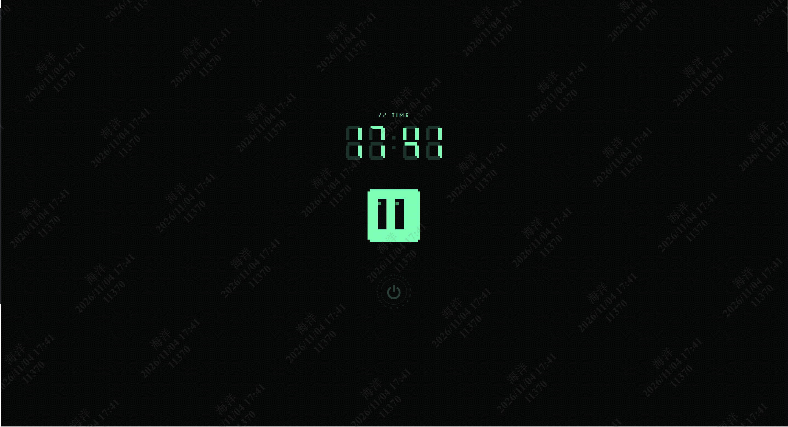
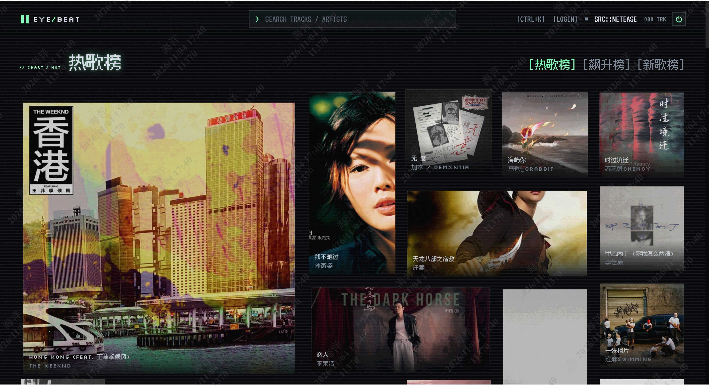
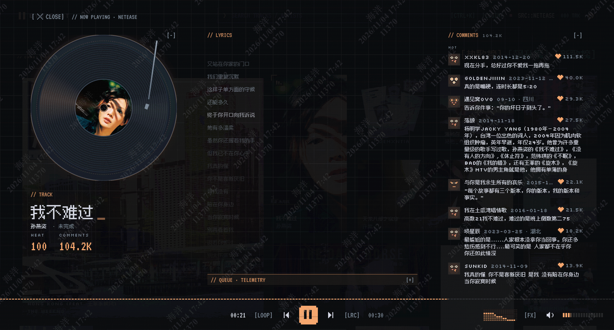

<div align="center">

# EYE/BEAT

**像素风封面墙音乐播放器** —— 把一首歌还原成一张封面，让整面墙跟着它变色。

<sub>Vue 3 · TypeScript · Pinia · Vite · PWA</sub>

[**▶ 在线体验**](https://bugdesigner-hy.github.io/eyeBeat/) ·
[部署状态](https://github.com/BugDesigner-Hy/eyeBeat/actions/workflows/deploy.yml) ·
[问题反馈](https://github.com/BugDesigner-Hy/eyeBeat/issues)

[](https://github.com/BugDesigner-Hy/eyeBeat/actions/workflows/deploy.yml)

</div>

<p align="center">
  
  
  
</p>

<p align="center"><sub>待机屏 · 封面墙 · 详情页</sub></p>

## 它在做什么

打开页面就落在一面封面墙上：歌曲以「封面」为最小单位排开，点开一张进入详情页开始播放，整套界面强调色由当前封面实时取色，换歌即换色。

视觉是像素 / 霓虹 / 终端：中文走 Ark Pixel 12px，拉丁文走 VT323 与 Silkscreen，动效尽量做成「机器正在工作」的样子。待机时屏幕像 CRT 老电视一样关掉，只留七段数码管时钟和一只盯着光标的机器人。

## 亮点

### 封面墙

- 两种布局：**瀑布流**（默认）与 **Folia 式无限画布**，命令面板里一键切换
- 键盘方向键在封面间移动，`Enter` 播放；也可用鼠标 / 触摸拖动浏览
- **准星锁定**：切歌时准星飞到当前歌曲的封面并锁住，不用在墙里找
- 封面信息可选常显歌名歌手，或仅在悬停 / 聚焦时出现

### 播放与音效

- 进度条与音量条，循环 / 单曲 / 随机三种模式
- 交叉淡入淡出（默认 4 秒，可关）
- 10 段 EQ，内置 flat / bass / vocal / electronic / lofi / radio 六套预设，也可手调成 custom
- Bitcrush 降位 lo-fi 效果，一键给整首歌上 8-bit 质感
- 频谱可视化驱动播放栏与机器人眼睛

### 详情页

- 黑胶封面旋转、歌词、评论、接下来播放（QUEUE）与数据面板
- 歌词多候选源（LRCLIB 为主，配置网易云后可选其歌词），支持单曲偏移 ±0.1s 与全局偏移补偿蓝牙延迟
- 桌面宽屏时评论栏 / 下方面板 / 左侧封面可分别折叠成细轨，把空间让给歌词
- 移动端手势：上滑看歌词、右滑看评论

### 待机与开机

- CRT 关机动画、七段数码管时钟、随光标转动的机器人
- 长按充能开机；键盘 `P` 直接关 / 开

### 音源与语言

| 音源 | 状态 | 说明 |
| --- | --- | --- |
| [Audius](https://audius.co) | 开箱可用 | 默认音源，无需任何配置 |
| 网易云 | 需自备 API | 需要本地或自建 API 代理，支持扫码登录 |
| [Jamendo](https://www.jamendo.com) | 需 client_id | CC 授权曲库，去 [Dev Portal](https://devportal.jamendo.com/) 申请 |

顶栏 `SRC::` 或命令面板切换音源；界面支持中文 / English（默认英文）。

### PWA

可安装到桌面 / 主屏，离线可用应用外壳；1.4 MB 的中文像素字体按 `unicode-range` 分片，用到哪片才下哪片，不进预缓存。

## 快速开始

**环境要求**：Node.js `20.19+` 或 `22.12+`（Vite 8 的硬要求）、pnpm 10+。

```bash
pnpm install
pnpm dev        # 开发服务器
```

浏览器打开终端提示的地址即可。开发模式下会自动拉起内置的网易云 API 子进程并代理到 `/ncm`（见 `.env.development`），所以本地默认音源是网易云。

```bash
pnpm build      # vue-tsc 类型检查 + 生产构建
pnpm preview    # 预览构建产物
```

## 配置

复制 [`.env.example`](.env.example) 为 `.env.local` 后按需修改，**改完要重启 dev server**。

| 变量 | 默认 | 说明 |
| --- | --- | --- |
| `VITE_MUSIC_PROVIDER` | `audius` | 默认音源：`audius` \| `netease` \| `jamendo` |
| `VITE_NETEASE_API_BASE` | 空 | 网易云 API 地址。以 `/` 开头时由 dev server 代理并自动起本地服务，如 `/ncm`；填完整 URL 则直接用 |
| `NETEASE_API_PORT` | `3000` | 内置网易云 API 端口 |
| `VITE_JAMENDO_CLIENT_ID` | 空 | 未配置时 Jamendo 不出现在切换列表 |
| `BASE_PATH` | `/` | 构建时的站点子路径，部署到 `https://<user>.github.io/eyeBeat/` 时为 `/eyeBeat/` |

## 部署

仓库自带 [GitHub Pages 工作流](.github/workflows/deploy.yml)：push 到 `main` 即自动构建并发布到 <https://bugdesigner-hy.github.io/eyeBeat/>。

fork 后自建步骤：

1. Settings → Pages → Source 选 **GitHub Actions**
2. 把 `.github/workflows/deploy.yml` 里 Build 步骤的 `BASE_PATH` 改成 `/<你的仓库名>/`
3. push 到 `main`

其他静态托管（Vercel / Netlify / 自建 Nginx）同理：构建时把 `BASE_PATH` 设成实际子路径，根路径部署则不用设。

## 键盘与手势

| 按键 | 作用 |
| --- | --- |
| `Space` | 播放 / 暂停 |
| `Shift` + `←` / `→` | 后退 / 前进 5 秒 |
| `←` `→` `↑` `↓` | 在封面墙中移动选择 |
| `Enter` | 播放选中的封面 |
| `L` | 歌词面板 |
| `B` | 折叠 / 展开播放栏 |
| `P` | 关机 / 开机 |
| `/` | 打开命令面板（进入搜索） |
| `Ctrl` / `Cmd` + `K` | 命令面板 |
| `Esc` | 逐层关闭浮层 |

命令面板里还有音源切换、EQ 预设、强调色、布局、语言、歌词偏移等全部开关。

移动端：上滑进入歌词、右滑进入评论，下滑返回。

## 项目结构

```
src/
  api/            音乐源适配器（audius / netease / jamendo）、歌词源（LRCLIB）
  audio/          Web Audio 引擎、EQ、bitcrusher
  components/     界面组件（封面墙、详情页、待机屏、命令面板…）
  composables/    相机 / 折叠 / 响应式等组合式逻辑
  stores/         Pinia：播放器、歌词、评论、设置、UI、账号
  utils/          六边形网格、取色、空间导航、IndexedDB 等
  i18n/           中英文案
public/           图标、像素字体
scripts/          网易云 API 的 Vite 插件、图标生成
```

## 扩展音源

新增一个音源只需三步：

1. 在 `src/api/providers/` 下实现 `src/api/types.ts` 里的 `MusicProvider`
2. 在 `src/api/index.ts` 注册
3. （可选）为它补 `shelves` 分区与登录能力

## 已知限制

- 网易云走非官方接口，随时可能失效且有合规风险；部署到公网时建议只用 Audius / Jamendo
- 曲库与音源稳定性取决于上游，本项目只做浏览器端缓存
- 本地存储键仍沿用 `himusic.*` 前缀（项目早期的包名），升级后一般无需清理

## 声明

- 本项目仅供学习与个人使用，请遵守各音乐平台的服务条款与版权规定
- 品牌名、像素字体与视觉资源请勿直接用于商业项目

## License

未指定开源许可证，保留所有权利。fork 后如公开发布，请自行补充 `LICENSE`，并替换可能引起混淆的品牌资源。
